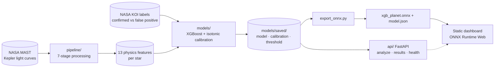
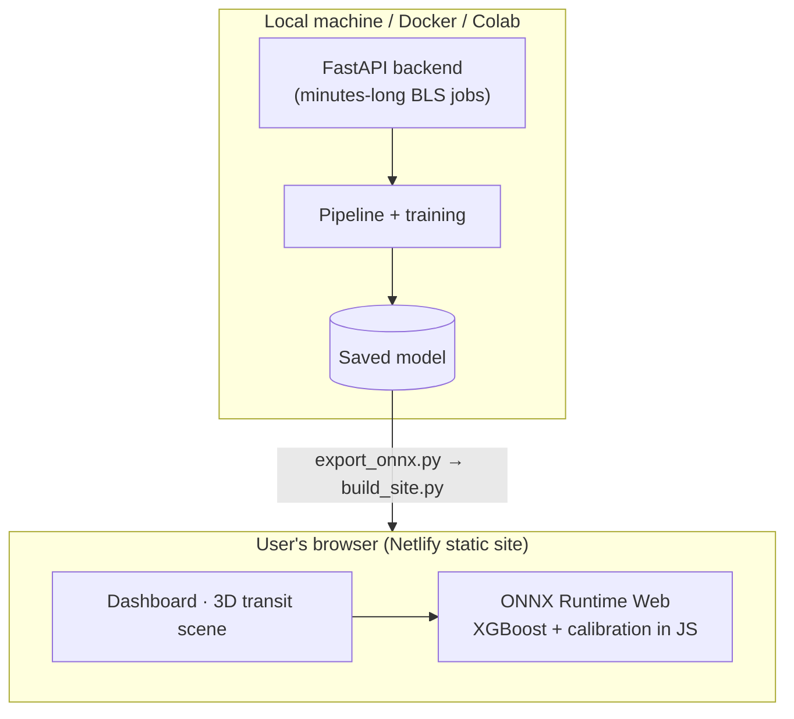
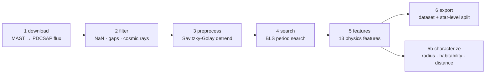
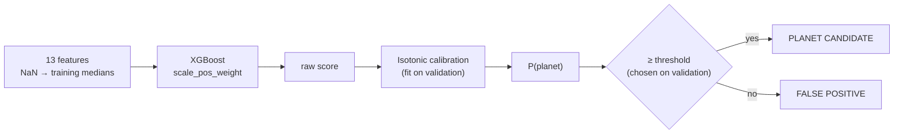

<div align="center">

# 🛰️ ExoDetect

### AI-enabled exoplanet detection from noisy Kepler light curves

**ISRO Bhartiya Antariksh Hackathon 2026** · Team R.M.K. College of Engineering and Technology

[](https://exodetect-isro-bah.netlify.app)


**[▶ Open the live dashboard](https://exodetect-isro-bah.netlify.app)** — the **Live Model** tab runs the trained classifier *inside your browser*.

</div>

---

## Contents

1. [The problem](#1-the-problem) · 2. [Approach](#2-approach) · 3. [System architecture](#3-system-architecture) · 4. [Pipeline workflow](#4-pipeline-workflow)
5. [ML design](#5-ml-design) · 6. [System design](#6-system-design) · 7. [Results](#7-results-honest-version) · 8. [Deployment](#8-deployment) · 9. [Quickstart](#9-quickstart)
10. [Repository layout](#10-repository-layout) · 11. [Engineering rules](#11-engineering-rules) · 12. [Status & roadmap](#12-status--roadmap) · 13. [Team](#13-team)

---

## 1. The problem

When a planet crosses in front of its star, the star dims by roughly **0.01 – 1 %**. Finding those dips in telescope data is hard because:

- the signal is tiny compared with stellar variability, instrument drift and noise;
- many dips are **impostors** — eclipsing binary stars, background blends — that look like planets;
- missions produce far more candidates than humans can vet.

## 2. Approach

A physics-aware pipeline cleans each light curve, searches for periodic dips (BLS), and measures **13 physical features** (depth, SNR, odd/even depth mismatch, secondary-eclipse ratio, transit shape, …). A **calibrated gradient-boosted classifier** then separates real planets from false positives and reports a *trustworthy probability*, not just a label.

We do not replace NASA's Robovetter — **we absorb its vetting ideas as features and add learned reasoning on top.**

## 3. System architecture



**Where things run**



The trained model is tiny (**14 KB** as ONNX), so classification is served as a **static asset with zero backend cost**. The heavy part (downloading and searching light curves) stays in the Python backend, which is why it is not a serverless function.

## 4. Pipeline workflow



| # | Script | What it does | Output |
|---|---|---|---|
| 1 | `pipeline/download.py` | Fetches Kepler quarters from MAST, keeps **PDCSAP_FLUX**, stitches | `data/raw/<star>.npy` |
| 2 | `pipeline/filter.py` | Removes NaNs, gaps, **upward-only** outliers (transits dip *down*) | `*_filtered.npy` |
| 3 | `pipeline/preprocess.py` | Savitzky-Golay detrend, window ≫ transit duration (48 h) | `*_detrended.npy` |
| 4 | `pipeline/search.py` | BLS period search (10-min binning above 200k points, 250k-trial capped grid) | `*_bls.npy` |
| 5 | `pipeline/features.py` | 13 features: period, duration, depth, SNR, SDE, noise, odd/even, secondary, V-metric, symmetry, duty cycle, #transits, #in-transit points | `*_features.json` |
| 5b | `pipeline/characterize.py` | Planet radius vs Earth/Jupiter, habitability *indicator*, distance | `*_characterization.json` |
| 6 | `pipeline/export.py` | Joins NASA labels; **star-level** 70/15/15 split (seed 42) | `dataset_tabular.csv`, `dataset_views.npz` |
| – | `pipeline/run_batch.py` | Orchestrates 1→6 for many stars; **resume-safe**, per-star error isolation | – |
| – | `pipeline/get_labels.py`, `fetch_stellar.py` | NASA KOI verdicts and stellar parameters | `labels.csv`, `stellar_params.csv` |

## 5. ML design



- **Model:** gradient-boosted trees; uses real XGBoost when installed, with a pure-NumPy fallback engine (`NumpyBoost`).
- **Calibration:** isotonic regression fitted on the validation split, so "0.8" means roughly 80 % of such candidates are real.
- **Threshold:** best-F1 on validation; the **test split is touched exactly once**.
- **Explainability:** exact TreeSHAP contributions per prediction (`predict_one`).
- **Labels:** trained only on **CONFIRMED vs FALSE POSITIVE** KOI dispositions — never on unresolved CANDIDATE rows.

## 6. System design

### Data contracts
| Artifact | Producer → consumer | Shape |
|---|---|---|
| `data/raw/<stem>.npy` | download → filter | time, flux, flux_err |
| `data/features/<stem>_features.json` | features → model / API | 13 floats |
| `models/saved/` | trainer → API / ONNX export | `xgb_planet.json`, `xgb_calibration.json`, `xgb_threshold.json`, `eval_report.json` |
| `xgb_planet.onnx` + `model.json` | export → browser | model graph + medians, isotonic map, threshold |

`<stem>` is the target name made filesystem-safe (`"KIC 123"` → `KIC_123`).

### API (`api/main.py`)
Long jobs (BLS can take minutes) run on a background thread; clients **poll**.

| Method | Path | Purpose |
|---|---|---|
| `GET` | `/health` | Liveness, whether a model is trained, stars analyzed |
| `POST` | `/analyze/{target}` | Start the full pipeline (returns `202`, idempotent while running) |
| `GET` | `/results/{target}` | Job status, features, characterization, calibrated model verdict |

```bash
uvicorn api.main:app --port 8000
curl -X POST http://127.0.0.1:8000/analyze/Kepler-10
curl http://127.0.0.1:8000/results/Kepler-10
```

### Key decisions and trade-offs
| Decision | Why | Trade-off |
|---|---|---|
| Split **by star**, never by row | A star's many transits would leak across splits and inflate scores | Fewer independent samples |
| Report **AUC-PR**, not accuracy | Classes are imbalanced; accuracy hides failures | Less familiar to non-ML readers |
| Calibrate, then threshold, both on val | Probabilities must be trustworthy; test stays untouched | Needs a held-out val set |
| Model exported to **ONNX** and run in the browser | 14 KB model → free, instant, private inference | The same preprocessing/calibration is mirrored in JS (verified against Python) |
| Backend kept off serverless | Dependencies (astropy, lightkurve) and multi-minute jobs don't fit function limits | Backend is run locally / Docker |
| In-memory job registry | Stages are resume-safe, so a restart just re-POSTs | Not multi-instance; swap for a queue + DB at scale |
| Habitability is an **indicator only** | Transits give size and orbit, not atmosphere | – |

## 7. Results (honest version)

Model on disk: XGBoost trained on the v1 sample (400 stars, 279 / 60 / 61 train / val / test, split by star).

| Split | n | AUC-PR | ROC-AUC | ECE (calibrated) |
|---|---|---|---|---|
| train | 279 | 0.9992 | 0.9991 | 0.0072 |
| val | 60 | 1.000 | 1.000 | 0.000 |
| test | 61 | 1.000 | 1.000 | 0.000 |

> ⚠️ **These near-perfect numbers are not the headline.** The v1 sample takes the highest-SNR stars per class; `depth_ppm` and `snr_bls` alone carry ~69 % of feature importance, so the task — not the model — is saturated.

| Benchmark | Test AUC-PR | Notes |
|---|---|---|
| v1 high-SNR sample | 1.000 | Too easy; loud signals only |
| Ablation: no `depth_ppm` / `snr_bls` | 0.913 | Physics features alone (secondary ratio, V-metric, noise, SDE) still classify |
| **v2 SNR-stratified (200/class, 40 per SNR quintile)** | **pending** | The honest benchmark; run `pipeline/run_batch.py --targets pipeline/targets_training_v2.csv`, then retrain |

Top feature importances: `depth_ppm` 0.51 · `snr_bls` 0.19 · `noise_ppm` 0.14 · `sde` 0.05 · `symmetry` 0.02 · `odd_even_diff` 0.02.

## 8. Deployment

| Piece | Where | How |
|---|---|---|
| Dashboard + ONNX classifier | **Netlify** (static) | `python scripts/build_site.py && netlify deploy --prod --dir dist` |
| FastAPI backend | Local / Docker / Colab | `uvicorn api.main:app` |
| Training | Laptop / Colab | scripts in `pipeline/` and `models/` |

Live site: **https://exodetect-isro-bah.netlify.app** — open the **Live Model** tab. Presets there are *illustrative synthetic inputs*, not real stars.

> The other dashboard tabs (Results, Browse, Anomalies, 3D scene) still use **simulated demo data**; they are the design spec for the full app.

## 9. Quickstart

```bash
pip install -r pipeline/requirements.txt
python pipeline/selftest.py                 # offline environment check, ~6 s
python models/xgboost_model.py --selftest   # offline model check, ~2 s

# full pipeline on real data (needs internet)
python pipeline/get_labels.py
python pipeline/download.py --batch pipeline/targets_training.csv
python pipeline/filter.py && python pipeline/preprocess.py
python pipeline/search.py && python pipeline/features.py
python pipeline/export.py --labels pipeline/labels.csv
python models/xgboost_model.py              # train + calibrate + report

# ship the model to the browser
pip install onnxmltools onnxruntime onnx
python models/export_onnx.py                # verifies ONNX == XGBoost (max diff ~1e-7)
python scripts/build_site.py                # -> dist/
```

## 10. Repository layout

```
.
├── api/                 FastAPI backend (analyze / results / health)
├── models/
│   ├── xgboost_model.py trainer, calibration, predict_one()
│   ├── evaluate.py      AUC-PR, ROC-AUC, ECE, isotonic (pure NumPy)
│   ├── export_onnx.py   XGBoost -> ONNX + web/model.json (with parity check)
│   └── saved/           trained model, calibration, threshold, eval report, .onnx
├── pipeline/            7-stage data pipeline + target/label lists
├── preview/index.html   dashboard (3D scene, results, Live Model tab)
├── scripts/build_site.py  assembles dist/ for deployment
├── web/model.json       browser-side medians, calibration, threshold, presets
└── netlify.toml
```

Large data (`data/`, `*.npy`, `*.npz`, `*.fits`, logs, pickles) is git-ignored and regenerated by the pipeline.

## 11. Engineering rules

`PDCSAP_FLUX`, not SAP_FLUX · Savitzky-Golay window ≫ transit duration · clip only **upward** outliers before detection · split by **star** · report **AUC-PR** · calibrate and pick the threshold on validation, touch test once · train on CONFIRMED vs FALSE POSITIVE only · novelty branch runs in **parallel**, not downstream.

## 12. Status & roadmap

| Piece | State |
|---|---|
| 7-stage data pipeline (`selftest.py` 9/9) | ✅ built |
| XGBoost + isotonic calibration + SHAP | ✅ trained (v1 sample) |
| FastAPI backend | ✅ working locally |
| ONNX export + in-browser classifier on Netlify | ✅ live |
| v2 SNR-stratified benchmark | ⏳ pending run |
| 1D-CNN (global + local), FP-specialist, meta-learner, novelty autoencoder | 🗺️ planned — shown in the dashboard as design, **not trained yet** |
| React frontend wired to the API | 🗺️ planned |
| Persisted job store (DB) and Docker image for the API | 🗺️ planned |

## 13. Team

| Role | Owns |
|---|---|
| Data + ML | `pipeline/`, CNN + LSTM |
| ML + XAI | XGBoost, FP-specialist, autoencoder, meta-learner, SHAP |
| Backend | FastAPI, database, Docker, deploy |
| Frontend | React, Three.js, dashboards |

---

<div align="center"><sub>Data: NASA Kepler / MAST and the NASA Exoplanet Archive KOI table. Habitability is an indicator derived from size and orbit — never a claim of life.</sub></div>
